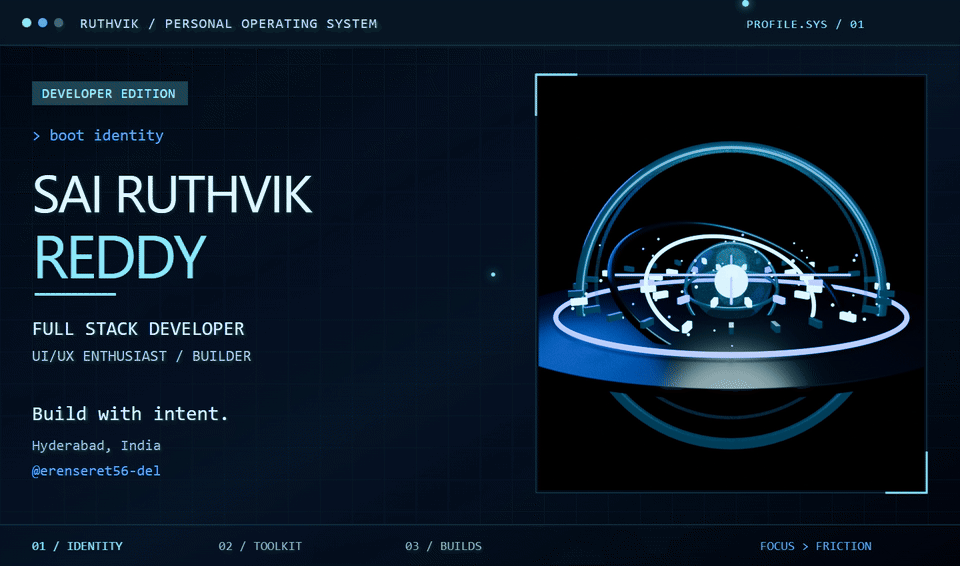
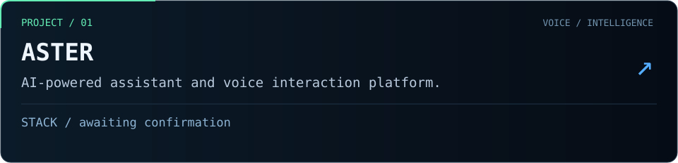
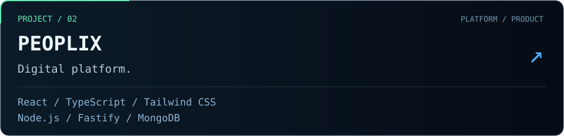
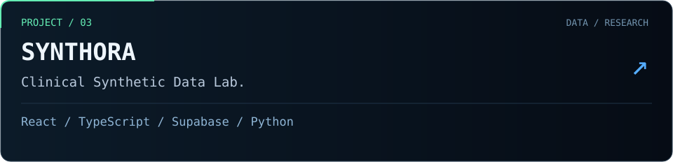
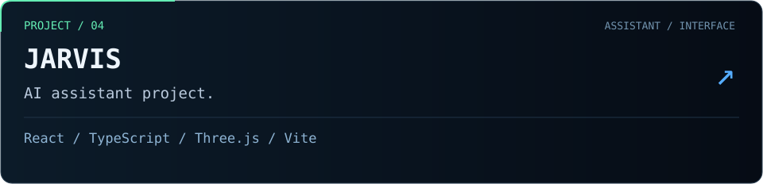
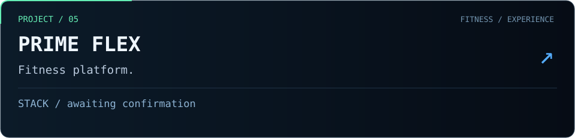
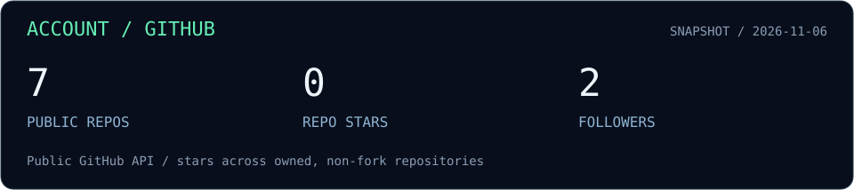
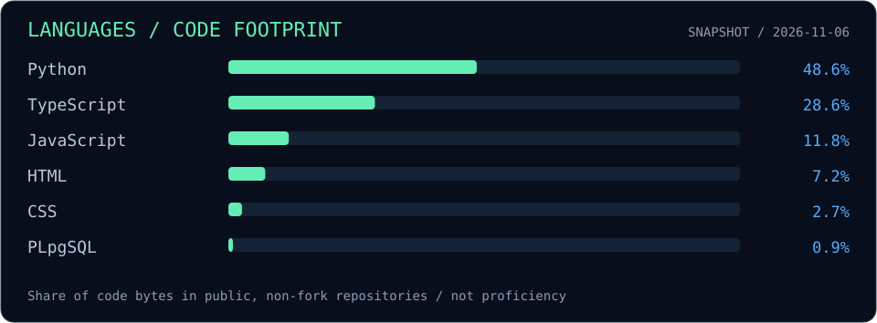
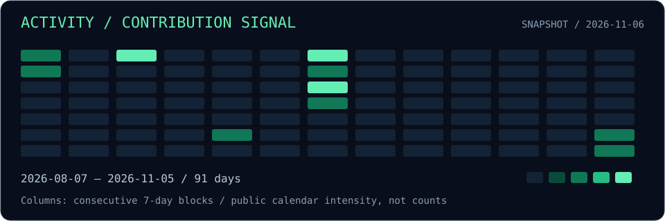
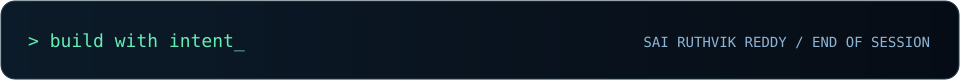

<p align="center">
  
</p>

<p align="center">
  <a href="#01--identity">IDENTITY</a> ·
  <a href="#03--toolkit">TOOLKIT</a> ·
  <a href="#04--selected-builds">BUILDS</a> ·
  <a href="#08--connect">CONNECT</a>
</p>

## 01 / Identity

```yaml
sai@dev:~$ whoami

name:       Sai Ruthvik Reddy
role:       Full Stack Developer | UI/UX Enthusiast | Builder
education:  Computer Science Engineering
college:    MLR Institute of Technology
location:   Hyderabad, India
github:     erenseret56-del

focus:      Full-stack products · Interface design · AI interactions
toolkit:    React · TypeScript · Node.js · Python · Figma
status:     Working at Peoplix
approach:   Hands-on development with tool-assisted workflows
```

## 02 / About me

I’m Sai, a developer based in Hyderabad, studying Computer Science Engineering at MLR Institute of Technology and working at **Peoplix**.

I build across frontend, backend and interface design, using development tools to turn ideas into working products. My projects explore AI assistants, voice interaction, digital platforms and clinical synthetic data.

**Design with intent. Build with focus. Keep improving.**

## 03 / Toolkit

Technologies I’ve worked with through hands-on, tool-assisted development. These are experience areas, not proficiency ratings.

| Area | Technologies |
| :--- | :--- |
| **Frontend** | <br>HTML · CSS · JavaScript · TypeScript<br>React · Next.js · Tailwind CSS |
| **Backend** | <br>Node.js · Express.js · REST APIs |
| **Databases** | <br>SQL · Supabase · MongoDB |
| **Programming** | <br>Python · Java |
| **Tools & platforms** | <br>Git · GitHub · VS Code<br>Figma · Vercel · Netlify |
| **Mobile & 3D** | <br>React Native · Expo · Three.js |

## 04 / Selected builds



**ASTER** · Repository and live demo: awaiting links. Stack: awaiting confirmation.



**Peoplix** · [Live platform ↗](https://peoplix.ai) · Repository: awaiting link.



**Synthora** · [Repository ↗](https://github.com/erenseret56-del/synthora) · [Related workspace ↗](https://github.com/erenseret56-del/Synthora-work) · Live demo: awaiting link.



**Jarvis** · [Repository ↗](https://github.com/erenseret56-del/Jarvis-) · Live demo: awaiting link.



**PRIME FLEX** · Repository and live demo: awaiting links. Stack: awaiting confirmation.

## 05 / GitHub telemetry

<p>
  <a href="https://github.com/erenseret56-del?tab=repositories"></a>
</p>
<p>
  <a href="https://github.com/erenseret56-del?tab=repositories"></a>
</p>
<p>
  <a href="https://github.com/erenseret56-del"></a>
</p>



<sub>Account, language and activity cards are dated snapshots of actual public GitHub data. The streak card is live and depends on service availability. Language usage is not a proficiency rating. [View current activity on GitHub ↗](https://github.com/erenseret56-del)</sub>

## 06 / Contribution loop

<picture>
  <source media="(prefers-color-scheme: dark)" srcset="https://raw.githubusercontent.com/erenseret56-del/erenseret56-del/output/github-snake-dark.svg" />
  <source media="(prefers-color-scheme: light)" srcset="https://raw.githubusercontent.com/erenseret56-del/erenseret56-del/output/github-snake.svg" />
  
</picture>

<sub>Refreshes daily · [GIF version ↗](https://raw.githubusercontent.com/erenseret56-del/erenseret56-del/output/github-snake.gif) · Generated from actual contributions. First run required after installation.</sub>

## 07 / Currently learning

```text
$ cat learning.queue
Specific learning topics awaiting update.
Current work: Peoplix.
```

## 08 / Connect

**[GitHub ↗](https://github.com/erenseret56-del)** &nbsp; / &nbsp; **[Peoplix ↗](https://peoplix.ai)** &nbsp; / &nbsp; **[Stackweb ↗](https://stackweb.net)**

<sub>Hyderabad, India · Email and social links awaiting confirmation.</sub>


